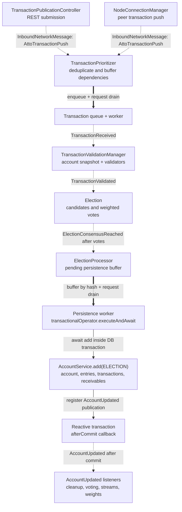
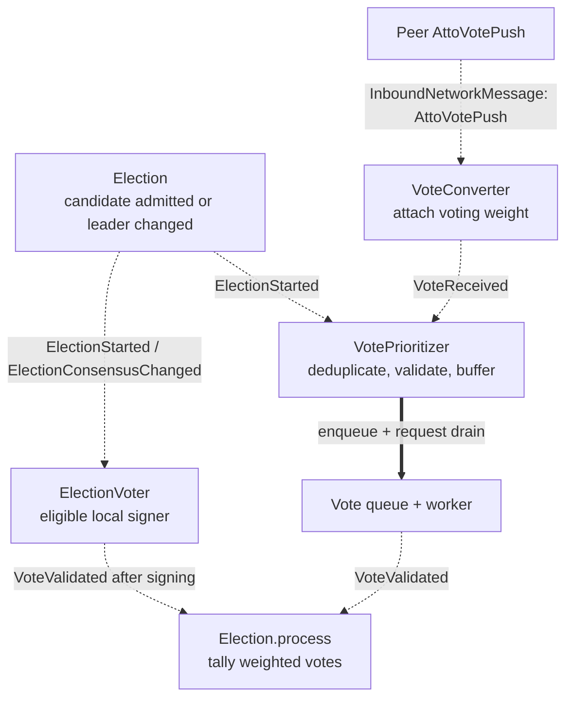

# Transaction Processing and Event Flow

Use this map to trace transaction admission, elections, local persistence, and the completion paths shared with bootstrap.
It describes selected runtime scenarios and the state-changing listeners they depend on; metrics and unrelated network
handlers are omitted. Verify the affected paths in current source before changing behavior.

- [Execution contract](#execution-contract)
- [Live transaction confirmation](#live-transaction-confirmation)
- [Vote processing](#vote-processing)
- [Events and completion](#events-and-completion)
- [State ownership and recovery](#state-ownership-and-recovery)
- [Bootstrap intersections](#bootstrap-intersections)
- [Trace an affected flow](#trace-an-affected-flow)

## Execution contract

The arrows below describe dependencies, not a global timeline. Independent listeners can finish in a different order
from publication, and a listener can publish another event before sibling listeners finish.

| Boundary | Implementation | What it guarantees |
| --- | --- | --- |
| Application event | [EventPublisher.publish][event-publisher] → Spring multicaster | Submits delivery to matching listeners. Publication does not await their completion. |
| Network message event | [NetworkMessagePublisher.publish][network-messages] → the same multicaster | Routes by the concrete wrapper and payload type, such as `InboundNetworkMessage<AttoTransactionPush>`. These messages do not implement the domain `Event` interface. |
| Listener dispatch | [ApplicationConfiguration.applicationEventMulticaster][application-config] | Uses a `SimpleAsyncTaskExecutor` with virtual threads and logs listener failures. This dispatcher supplies no FIFO completion or automatic redelivery guarantee. |
| Queue/worker handoff | [DemandDrivenWorker][worker] plus the caller's owned queue | Coalesces wakeups and drains work in its coroutine. On an exception it requests another drain with backoff; the owner must retain failed work. A wakeup is not the work item. |
| Transaction admission | [TransactionPrioritizer][transaction-prioritizer] → `TransactionReceived` | Claims the pending hash under the queue's group lock before publishing. Validation and election completion cannot precede this registration. |
| Direct suspending call | For example, [AccountService.add][account-service] | The caller awaits the called operation. Any events it publishes still have their own dispatch boundary. |
| After-commit publication | [EventPublisher.publishAfterCommit][event-publisher] | Registers a reactive transaction callback; publishes only after commit. The callback does not await the event consumers. |

Event publication is in-process. It is not a durable queue or proof that a consumer completed. An `@Order` annotation
alone would not serialize asynchronous listener completion. Check each state owner's synchronization separately.

In the diagrams, **dashed arrows** mean asynchronous event delivery, **thick arrows** mean an owned queue/worker
handoff, and **solid arrows** mean the direct call or transaction callback named on the arrow.

## Live transaction confirmation

This diagram follows a transaction that passes validation and reaches consensus. Other listeners and failure branches
are listed in [Events and completion](#events-and-completion).



1. **Admission:** [TransactionPublicationController.publishAndConfirm][transaction-publication] checks transaction structure and
   network, registers a hash-specific pending result, and publishes a REST-sourced message. Peer pushes come through
   [NodeConnectionManager.manage][connections]. Both reach `TransactionPrioritizer.add(message)`; rebroadcast tracking
   independently observes the same message.
2. **Prioritization:** [TransactionPrioritizer][transaction-prioritizer] suppresses duplicate hashes, buffers transactions
   whose send/previous dependency is a known pending transaction, and queues the rest. Its demand-driven worker
   rechecks dependencies and claims the pending hash while the queue holds its group lock, then publishes
   `TransactionReceived` after that lock is released. Queued hashes are deduplicated by the queue. Pending capacity
   includes validation, elections, and persistence; publication does not wait for validation listeners to finish.
3. **Validation:** [TransactionValidationManager.process][validation] loads an account snapshot and calls supported
   validators in order, stopping at the first violation. [BlockValidator][block-validator] checks height and other block
   rules; [PreviousValidator][previous-validator] checks the exact previous hash; [ReceiveValidator][receive-validator]
   checks the receivable for receive/open blocks. The result is `TransactionRejected` or `TransactionValidated`.
   An unexpected lookup/validator exception produces `TransactionValidationFailed`; cancellation still propagates.
4. **Election:** [Election.start][election] owns candidate admission and publishes `ElectionStarted`. Validated votes
   can change the provisional leader or reach consensus. On consensus it removes the active election, keeps a
   `pendingConsensus` marker for that public key/height, publishes `ElectionLost` for other candidates,
   and publishes `ElectionConsensusReached`. This is a consensus result; the transaction is still awaiting local persistence.
   A candidate arriving while the same public key/height awaits persistence, or at a cached confirmed height,
   receives `ElectionRejected`, implementing `TransactionFailure`, so its pending prioritizer state can be released.
   The confirmed-height cache stores the highest committed height for up to 100,000 accounts; delayed older updates
   cannot lower a retained height. This cache avoids stale admission without an account query, but eviction can permit
   a stale attempt. Persistence still reconciles such attempts against committed account state.
5. **Persistence:** [ElectionProcessor.process][election-processor] buffers the result by hash and requests its worker.
   The worker selects an insertion-ordered batch with distinct public keys and directly calls `AccountService.add`
   within a reactive transaction. Account updates, historical entries, transactions, and receivable changes share that
   transaction. `AccountUpdated` is registered during this work and published after commit.
   If a failed batch is already obsolete according to the existing account reconciliation read, the processor publishes
   `ElectionDiscarded` before removing that work. Unresolved work and failed outcome publications remain queued for retry.
6. **Completion:** independently dispatched `AccountUpdated` listeners clear election/persistence state, update voting
   state, and notify streams. Election retires work for the account at or below the committed height and emits failure
   events for other candidates. The prioritizer releases the matching hash on `AccountUpdated` or a processing failure,
   then requeues its buffered dependents. A published completion event does not mean every listener has finished.
   Bootstrap also produces this event; consumers must inspect its source where behavior differs.

## Vote processing

Local voting starts from `ElectionStarted`, not directly from `TransactionValidated`. Network votes can arrive before
that listener runs, so [VotePrioritizer][vote-prioritizer] has a buffer for votes without a known election.
The two `Election` boxes show the publishing and consuming roles of the same component.



[ElectionVoter][election-voter] also reacts to consensus reached and expiring/expired elections. After an
`AccountUpdated` from `ELECTION`, it launches final-vote publication for the committed transaction; bootstrap-sourced
updates do not take this branch. An `OLD_TRANSACTION` rejection has a separate account-lookup path for final voting.
Provisional votes broadcast to voters; final votes broadcast to everyone. Network publication and local `VoteValidated`
publication remain separate asynchronous deliveries.

[VoteRebroadcaster][vote-rebroadcaster] independently tracks `VoteReceived`, queues `VoteValidated` for rebroadcast,
and cleans up rejected/dropped votes. [TransactionRebroadcaster][transaction-rebroadcaster] independently tracks inbound
transactions and reacts to validation, rejection, and queue drops. Its dequeue remains scheduled.

## Events and completion

These tables index the relevant behavior listeners, excluding metrics. Read each listed handler's guards: being a
listener does not mean every event changes its state. Definitions live beside their domain types in
[Transaction.kt][transaction-types], [Election events][election-types], [Vote.kt][vote-types], and [Account.kt][account-types].

| Event/message | Producer | Behavior listeners |
| --- | --- | --- |
| `InboundNetworkMessage<AttoTransactionPush>` | [TransactionPublicationController][transaction-publication], [NodeConnectionManager][connections] | [TransactionPrioritizer.add][transaction-prioritizer], [TransactionRebroadcaster.process][transaction-rebroadcaster] |
| `TransactionReceived` | [TransactionPrioritizer.drain][transaction-prioritizer] | [TransactionValidationManager.process][validation] |
| `TransactionValidated` | [TransactionValidationManager.process][validation] | [Election.start][election], [TransactionRebroadcaster.process][transaction-rebroadcaster] |
| `TransactionRejected` | [TransactionValidationManager.process][validation] | [TransactionPrioritizer][transaction-prioritizer], [TransactionRebroadcaster][transaction-rebroadcaster], [VotePrioritizer][vote-prioritizer], [ElectionVoter][election-voter], [DependencyDiscoverer][dependency-discoverer], [TransactionPublicationController][transaction-publication] |
| `TransactionValidationFailed` | [TransactionValidationManager.process][validation] | [TransactionPrioritizer][transaction-prioritizer], [TransactionPublicationController][transaction-publication] |
| `TransactionDropped` | [TransactionPrioritizer][transaction-prioritizer], on queue eviction | [TransactionPrioritizer][transaction-prioritizer], [TransactionRebroadcaster][transaction-rebroadcaster], [TransactionPublicationController][transaction-publication] |
| `ElectionStarted` | [Election.start][election] | [VotePrioritizer][vote-prioritizer], [ElectionVoter][election-voter] |
| `ElectionRejected` | [Election.start][election], for pending/completed heights; completion cleanup for historical candidates | [TransactionPrioritizer][transaction-prioritizer] through `TransactionFailure`, [TransactionPublicationController][transaction-publication] |
| `ElectionDiscarded` | [ElectionProcessor][election-processor], after reconciliation observes a committed height at or beyond the candidate | [Election][election], [TransactionPrioritizer][transaction-prioritizer] through `TransactionFailure` |
| `ElectionConsensusChanged` | [Election.process][election] | [ElectionVoter][election-voter] |
| `ElectionConsensusReached` | [Election.process][election] | [ElectionProcessor][election-processor], [ElectionVoter][election-voter], [FinalVoteRecorder][final-votes], [VoteTimestampRecorder][vote-timestamps] |
| `ElectionExpiring` | [Election.notifyExpiring][election], scheduled | [ElectionVoter][election-voter], [ElectionProcessor][election-processor] |
| `ElectionExpired` | [Election.expireOld][election], scheduled | [TransactionPrioritizer][transaction-prioritizer], [VotePrioritizer][vote-prioritizer], [ElectionVoter][election-voter], [TransactionPublicationController][transaction-publication] |
| `ElectionLost` | [Election][election], on consensus, expiry, or account completion | [TransactionPrioritizer][transaction-prioritizer] |
| `VoteReceived` | [VoteConverter][vote-converter] | [VotePrioritizer][vote-prioritizer], [VoteRebroadcaster][vote-rebroadcaster] |
| `VoteValidated` | [VotePrioritizer.drain][vote-prioritizer], [ElectionVoter][election-voter] | [Election][election], [VoteRebroadcaster][vote-rebroadcaster], [VoteWeighter][vote-weighter] |
| `VoteRejected` | [VotePrioritizer.add][vote-prioritizer], on vote validation failure | [VoteRebroadcaster][vote-rebroadcaster] |
| `VoteDropped` | [VotePrioritizer][vote-prioritizer], including buffer eviction | [VoteRebroadcaster][vote-rebroadcaster], [DependencyDiscoverer][dependency-discoverer] |

| After-commit event | Registered by | Behavior listeners |
| --- | --- | --- |
| `AccountUpdated` | [AccountService.add][account-service], for `ELECTION` or `BOOTSTRAP` | [TransactionPrioritizer][transaction-prioritizer], [Election][election], [ElectionProcessor][election-processor], [ElectionVoter][election-voter], [VotePrioritizer][vote-prioritizer], [VoteCleaner][vote-cleaner], [VoteWeighter][vote-weighter], [AccountController][account-controller], [TransactionPublicationController][transaction-publication], [TransactionController][transaction-controller] |
| `ReceivableSaved` | [ReceivableService.saveAll][receivable-service], after a successful insert | [ReceivableController][receivable-controller]; each stream buffers live updates before scanning the database, then suppresses notifications matching retained database hashes |
| `AccountEntrySaved` | [AccountEntryService.saveAll][entry-service], historical nodes | [AccountEntryController][entry-controller] |

`TransactionFailure` is the shared contract for transaction/election admission rejection, validation exceptions,
queue drops, obsolete persistence discards, election loss, and election expiry. The prioritizer consumes it to release pending state and requeue
dependents for normal validation.
`TransactionFailure.recoverable` determines whether the same hash can retry immediately: validation exceptions and
election expiry are recoverable, while transaction rejections derive the flag from their rejection reason. Other
failures default to retaining time-based duplicate suppression.
`TransactionDropped` describes queued work and does not remove an active pending registration with the same hash.

`TransactionPublicationController` completes pending publication results on confirmation, rejection, validation exceptions,
election admission rejection, election expiry, or queue drop; `ALREADY_CONFIRMED` is handled as confirmation. On
`ElectionRejected`, a stored exact hash completes successfully; otherwise the request receives HTTP 409. Lookup
failures and validation exceptions return a generic HTTP 500 without exposing their cause. It does not listen to
`ElectionLost` or `ElectionDiscarded`. A request timeout does not
prove the transaction failed to commit. The separate [TransactionController][transaction-controller] consumes
`AccountUpdated` independently to emit its live query feeds; publication confirmation does not wait for those streams.
Historical vote and timestamp recording have their own queues; they are not
part of the account transaction merely because they consume the consensus event.

## State ownership and recovery

| State | Owner and synchronization | Completion/failure behavior to preserve |
| --- | --- | --- |
| Pending HTTP publication attempts | [PendingTransactionRegistry][pending-publications], owned by [TransactionPublicationController][transaction-publication]; concurrent hash map with per-hash registration/removal of waiter counts and replayed results | Registration precedes publication. Same-hash requests can share one attempt; joining and retiring waiters update membership and counts atomically so a retiring caller cannot detach a new waiter; each caller removes only its own registration on completion or cancellation. A suspended election-rejection lookup completes only the attempt it observed, so it cannot replace a confirmation or complete a newer publication. |
| Pending hashes and dependent transactions | [TransactionPrioritizer][transaction-prioritizer]; concurrent map, with atomic operations per dependency hash | The single worker registers each dispatched hash before validation. `computeIfPresent` attaches hash-deduplicated dependents; `AccountUpdated` and processing failures detach only the completed hash, then requeue dependents outside map callbacks. Election owners report stale/obsolete candidates through failure events. The inbound duplicate filter is advisory; queue admission and the pending claim enforce unique processing. |
| Transaction priority queue and queued hash membership | [TransactionQueue][transaction-queue]; existing lock per priority group | Queue admission and dequeue claims run under the same group lock, preventing a duplicate from slipping between queue removal and pending registration. The queue deduplicates hashes even when arrival metadata or work differs. Callbacks do not mutate the queue or publish events; deferred candidates leave the queue only after their dependency takes ownership. |
| Candidates, votes, pending consensus, cached confirmed heights | [Election][election]; one coroutine mutex for keyed elections, pending markers, their per-account height index, the bounded confirmed-height cache, clear, and detached diagnostic snapshots | Consensus moves the public key/height into `pendingConsensus` while retaining its index membership. `AccountUpdated` and `ElectionDiscarded` advance the retained confirmed height and inspect only that account's indexed active/pending heights for retirement. Newer work is preserved. Exact-height competitors receive `ElectionLost`; historical candidates receive `ElectionRejected`. Expiry and clear also remove index membership. Admission rejects pending or cached completed heights. Snapshot and size queries suspend on the same mutex as transitions. The synchronous Spring info contributor, gauge callback, and CacheSupport clear boundary use localized blocking bridges. Diagnostics copy nested candidates, votes, weights, and quorum while holding the mutex; readers cannot mutate live elections. |
| Votes awaiting an election and priority queue | [VotePrioritizer][vote-prioritizer]; mutex plus concurrent election membership | `ElectionStarted` releases buffered votes; rejection drops buffered votes; account completion and expiry remove active membership. |
| Consensus awaiting local persistence | [ElectionProcessor][election-processor]; `bufferLock`, hash-keyed `LinkedHashMap`, one drain worker | Exact duplicates retain their insertion position. A batch stops before repeating a public key; remaining work stays queued. On persistence failure, reuse the account reconciliation read and publish `ElectionDiscarded` before removing obsolete work. Publication occurs outside the buffer lock; failure retains that work. Unresolved entries remain queued for retry. |
| Final votes awaiting persistence | [VoteService][vote-service]; `bufferLock` protects the FIFO buffer and clear generation, with one drain worker | Each batch deduplicates signatures before insertion. Failed batches return ahead of newer votes for the worker's retry; cancellation propagates. Clearing advances the generation so an in-flight failure cannot restore cleared votes. Repository I/O runs outside the lock. |
| Account and receivable caches | [AccountRepository][account-repository], [ReceivableRepository][receivable-repository]; reactive transaction resources and completion callbacks | Account cache updates after commit and evicts on rollback/unknown completion. Receivable cache replacement/removal is conditional on the pending entry's identity, preventing a late callback from restoring deleted state. These callbacks are separate from `AccountUpdated` listeners. |
| Account stream snapshot and latest heights | [AccountController][account-controller]; registered SharedFlow subscription and one height map per collection | `onSubscription` reads the database after registration. Concurrent live emissions wait until that subscriber finishes its snapshot; the same subscription then delivers live updates. `forwardHeightBy` suppresses equal/older heights per requested address. Cancellation or a failed query detaches the subscriber. |
| Transaction and account-entry stream snapshots | [TransactionController][transaction-controller] and [AccountEntryController][account-entry-controller]; one registered SharedFlow subscription per hash or account range | `onSubscription` reads the database after registration, then the same subscription supplies live updates. Hash streams take one result; range streams sort and deduplicate by height and complete at the requested count. Cancellation detaches the subscription and cancels a pending snapshot read. |
| Receivable stream snapshot hashes and live buffer | [ReceivableController][receivable-controller]; one collecting coroutine owns the snapshot hash set, one child collector sends to a bounded live channel | Live subscription starts before the database scan. Database hashes remain for delayed overlapping notifications; live-only hashes are never added. The stream drains database rows before consuming live updates. Backpressure suspends live producers, and cancellation or a failed scan cancels the live collector and channel. |
| Local voting/signing jobs | [ElectionVoter][election-voter]; consensus state, mutexes, coroutine jobs | Provisional updates, cancellation, and committed final-vote publication have distinct lifecycles. Trace them before changing cleanup. |
| Bootstrap persistence observations and admission target | [BootstrapLoadMonitor][bootstrap-load]; synchronized recording and polling, with a volatile capacity snapshot | Insert completion records elapsed time, successful discovery persistence records attempted rows after commit, and non-cancelled failure records a reset. Each poll consumes its accumulated observations once. Metric registration and meter values do not drive admission. |

The intended admission invariant is **one current election height per public key**, with competing hashes at that
height. Validate it through the account snapshot, predecessor checks, and reachable transitions. Do not confuse it with
**one public key per save batch**, which is a separate persistence constraint enforced by `AccountService.add`.

## Bootstrap intersections

Bootstrap can reach the same persistence and completion owners without traversing a normal election. See
[README: Bootstrapping / catching up](README.md#bootstrapping--catching-up) for the broader discovery overview.

| Crossing | Actual calls/events | Why it matters |
| --- | --- | --- |
| Live rejection → dependency discovery | [DependencyDiscoverer][dependency-discoverer] tracks recoverable `TransactionRejected` events and qualifying final `VoteDropped` events; sufficient weight leads to a direct `DiscoveryQueue.queue` call | A rejected live attempt can later enter bootstrap recovery. |
| Discovery → unchecked storage | [DiscoveryQueue][discovery-queue] admits to its bounded buffer, then publishes `TransactionDiscovered`. [BootstrapController.run][bootstrap-controller] drives [DiscoveryPersistenceWorker.persist][discovery-persistence] | `TransactionDiscovered` is a notification after admission, not the command that persists the transaction. |
| Unchecked persistence → adaptive admission | [UncheckedTransactionInserter][unchecked-inserter] records insert-only elapsed time in `finally`; [DiscoveryPersistenceWorker][discovery-persistence] records committed attempted rows or non-cancelled failure directly into [BootstrapLoadMonitor][bootstrap-load] | The next controller poll aggregates those observations. SQL affected rows and whole-save duration remain separate measurements; cancellation does not record a persistence failure. |
| Unchecked storage → committed account | [UncheckedTransactionProcessor][unchecked-processor] directly calls `TransactionValidationManager.validate`; on success it calls `AccountService.add(BOOTSTRAP)` inside its resolution transaction | This path bypasses `TransactionReceived`, `TransactionValidated`, and normal election admission, while still producing after-commit `AccountUpdated`. |
| Missing dependency → send discovery | On validation failure, [UncheckedTransactionProcessor][unchecked-processor] publishes `TransactionStuck` and skips later candidates for that public key in the batch. [SendDiscoverer][send-discoverer] consumes `TransactionStuck` and `TransactionDiscovered` | Applicable receive/open transactions trigger discovery of a missing send; follow this loop before treating unchecked work as terminally rejected. |
| Bootstrap head → discovery | [LastDiscoverer.processVoteResponse][last-discoverer] calls `DiscoveryQueue.queue` after collected votes reach quorum | Expired or capacity-evicted collections are discarded without starting a live election. A later head advertisement can start another discovery attempt. |
| Scheduled head advertisement → peers | [BootstrapHeadBroadcaster.broadcastSample][head-broadcaster] samples stored transactions once per minute on a historical node with no unchecked backlog, then awaits connection-manager sends | Outbound advertising has its own mutex and lifecycle; it does not own inbound quorum collection. |
| Shared completion → source-specific reaction | `AccountUpdated.source` distinguishes `BOOTSTRAP` and `ELECTION` | Most completion owners see both. `ElectionVoter` filters bootstrap updates from its committed-election final-vote path. |

## Trace an affected flow

Use this procedure when investigating events, changing an invariant, or updating this map. Limit the trace to the
scenario and shared state affected by the change; an unrelated edit does not require a whole-repository call graph.

1. **Choose the scenario and invariant.** Name the entry point, transaction hash/public key/height, account snapshot,
   predecessor or send hash, and expected outcome. Include a failure or delayed-event scenario when relevant.
2. **Find the exact type and all producers/consumers.** Search the event type, including generic message payloads.
   Follow construction into variables, publisher wrappers, helper methods, and every production listener. Include
   controllers, recovery, cleanup, and metrics listeners when their behavior affects the question. Search direct
   callers of those methods too; annotations and event names alone do not describe the full path.
3. **Record each relevant edge.** Use the format below with actual symbols and source links. Follow direct validator,
   repository, and service calls as well as events. For a queued edge, record enqueue, wakeup, drain, and removal.
   For a completion signal, identify who owns, completes, and observes it, including failure/cancellation semantics.

   | Producer/caller → consumer/callee | Boundary and completion point | Guard, state owner, failure/cleanup |
   | --- | --- | --- |
   | `Election.process` → `ElectionProcessor.process` | Async `ElectionConsensusReached`; listener only buffers work | Pending consensus lifecycle; processor owns persistence buffer; drain retries unresolved work |
   | `ElectionProcessor.flushBatch` → `AccountService.add` | Awaited call inside a reactive DB transaction | Distinct public keys per batch; after-commit events have separate delivery |
   | `TransactionPrioritizer.drain` → validation | Registers the pending hash, then publishes asynchronous `TransactionReceived` | `AccountUpdated` and `TransactionFailure` remove pending state, requeue dependents, and request another drain |

4. **Establish ordering from code.** Read the multicaster, coroutine scopes, locks, queues, schedules, transaction
   operators, and commit/rollback/unknown callbacks. Separate guaranteed order from a possible interleaving. Event
   timestamps, source-file order, and a successful `publish` call do not establish consumer completion order.
5. **Close the feedback loops.** Follow events emitted by listeners through retry, expiry, cancellation, cache
   invalidation, and completion. Check alternate/bootstrap producers that mutate the same owner. Stop when the
   affected invariant and recovery path are explained; record any unresolved edge instead of assuming behavior.
6. **Validate reachability and maintain the map.** Check that test inputs pass upstream validation and predecessor
   checks. Exercise the relevant normal, delayed/duplicate, or failure order. Update the affected arrows, event rows,
   and source links together with the code; distinguish verified behavior from a proposed invariant.

Starting searches from the repository root:

```bash
# Find the exact event/message and its uses, not just listener annotations.
rg -n 'AccountUpdated|ElectionConsensusReached|InboundNetworkMessage<AttoTransactionPush>' src/main/kotlin

# Inspect dispatch and worker behavior, then the affected owners found above.
rg -n 'publishEvent|afterCommit|setTaskExecutor|setErrorHandler|drain|request' src/main/kotlin/cash/atto/node/{Event,ApplicationConfiguration,DemandDrivenWorker}.kt

# Scope deeper mechanism searches to the files/packages identified in your trace.
# If investigating election persistence, for example:
rg -n 'publishAfterCommit|@EventListener|@Order|@Scheduled|worker.request|executeAndAwait|invokeOnCompletion|complete\(' src/main/kotlin/cash/atto/node/election

# Find existing behavior tests after identifying the affected owners.
rg -n 'AccountUpdated|ElectionConsensusReached|ElectionLost' src/test
```

Search matches are an inventory, not a complete call graph. Read the method bodies and follow variables and direct
calls. Keep source links to files and named methods so routine line movement does not invalidate this reference.

[event-publisher]: src/main/kotlin/cash/atto/node/Event.kt
[application-config]: src/main/kotlin/cash/atto/node/ApplicationConfiguration.kt
[network-messages]: src/main/kotlin/cash/atto/node/network/NetworkMessage.kt
[worker]: src/main/kotlin/cash/atto/node/DemandDrivenWorker.kt
[connections]: src/main/kotlin/cash/atto/node/network/NodeConnectionManager.kt
[transaction-types]: src/main/kotlin/cash/atto/node/transaction/Transaction.kt
[transaction-controller]: src/main/kotlin/cash/atto/node/transaction/TransactionController.kt
[transaction-publication]: src/main/kotlin/cash/atto/node/transaction/TransactionPublicationController.kt
[transaction-prioritizer]: src/main/kotlin/cash/atto/node/transaction/prioritization/TransactionPrioritizer.kt
[transaction-queue]: src/main/kotlin/cash/atto/node/transaction/prioritization/TransactionQueue.kt
[transaction-rebroadcaster]: src/main/kotlin/cash/atto/node/transaction/TransactionRebroadcaster.kt
[validation]: src/main/kotlin/cash/atto/node/transaction/validation/TransactionValidationManager.kt
[block-validator]: src/main/kotlin/cash/atto/node/transaction/validation/validator/BlockValidator.kt
[previous-validator]: src/main/kotlin/cash/atto/node/transaction/validation/validator/PreviousValidator.kt
[receive-validator]: src/main/kotlin/cash/atto/node/transaction/validation/validator/ReceiveValidator.kt
[election]: src/main/kotlin/cash/atto/node/election/Election.kt
[election-types]: src/main/kotlin/cash/atto/node/election/Election.kt
[election-processor]: src/main/kotlin/cash/atto/node/election/ElectionProcessor.kt
[election-voter]: src/main/kotlin/cash/atto/node/election/ElectionVoter.kt
[final-votes]: src/main/kotlin/cash/atto/node/election/FinalVoteRecorder.kt
[vote-timestamps]: src/main/kotlin/cash/atto/node/election/VoteTimestampRecorder.kt
[account-types]: src/main/kotlin/cash/atto/node/account/Account.kt
[account-service]: src/main/kotlin/cash/atto/node/account/AccountService.kt
[account-repository]: src/main/kotlin/cash/atto/node/account/AccountRepository.kt
[account-controller]: src/main/kotlin/cash/atto/node/account/AccountController.kt
[receivable-service]: src/main/kotlin/cash/atto/node/receivable/ReceivableService.kt
[receivable-repository]: src/main/kotlin/cash/atto/node/receivable/ReceivableRepository.kt
[receivable-controller]: src/main/kotlin/cash/atto/node/receivable/ReceivableController.kt
[entry-service]: src/main/kotlin/cash/atto/node/account/entry/AccountEntryService.kt
[entry-controller]: src/main/kotlin/cash/atto/node/account/entry/AccountEntryController.kt
[vote-types]: src/main/kotlin/cash/atto/node/vote/Vote.kt
[vote-converter]: src/main/kotlin/cash/atto/node/vote/convertion/VoteConverter.kt
[vote-prioritizer]: src/main/kotlin/cash/atto/node/vote/prioritization/VotePrioritizer.kt
[vote-rebroadcaster]: src/main/kotlin/cash/atto/node/vote/VoteRebroadcaster.kt
[vote-cleaner]: src/main/kotlin/cash/atto/node/vote/VoteCleaner.kt
[vote-service]: src/main/kotlin/cash/atto/node/vote/VoteService.kt
[vote-weighter]: src/main/kotlin/cash/atto/node/vote/weight/VoteWeighter.kt
[dependency-discoverer]: src/main/kotlin/cash/atto/node/bootstrap/discovery/DependencyDiscoverer.kt
[discovery-queue]: src/main/kotlin/cash/atto/node/bootstrap/discovery/DiscoveryQueue.kt
[discovery-persistence]: src/main/kotlin/cash/atto/node/bootstrap/discovery/DiscoveryPersistenceWorker.kt
[bootstrap-controller]: src/main/kotlin/cash/atto/node/bootstrap/BootstrapController.kt
[bootstrap-load]: src/main/kotlin/cash/atto/node/bootstrap/BootstrapLoadMonitor.kt
[unchecked-inserter]: src/main/kotlin/cash/atto/node/bootstrap/unchecked/UncheckedTransactionInserter.kt
[unchecked-processor]: src/main/kotlin/cash/atto/node/bootstrap/unchecked/UncheckedTransactionProcessor.kt
[last-discoverer]: src/main/kotlin/cash/atto/node/bootstrap/discovery/LastDiscoverer.kt
[head-broadcaster]: src/main/kotlin/cash/atto/node/bootstrap/discovery/BootstrapHeadBroadcaster.kt
[send-discoverer]: src/main/kotlin/cash/atto/node/bootstrap/discovery/SendDiscoverer.kt

[account-entry-controller]: src/main/kotlin/cash/atto/node/account/entry/AccountEntryController.kt

[pending-publications]: src/main/kotlin/cash/atto/node/transaction/PendingTransactionRegistry.kt
