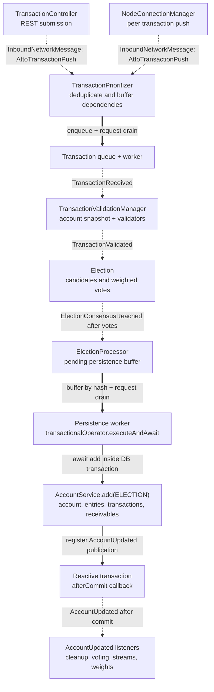
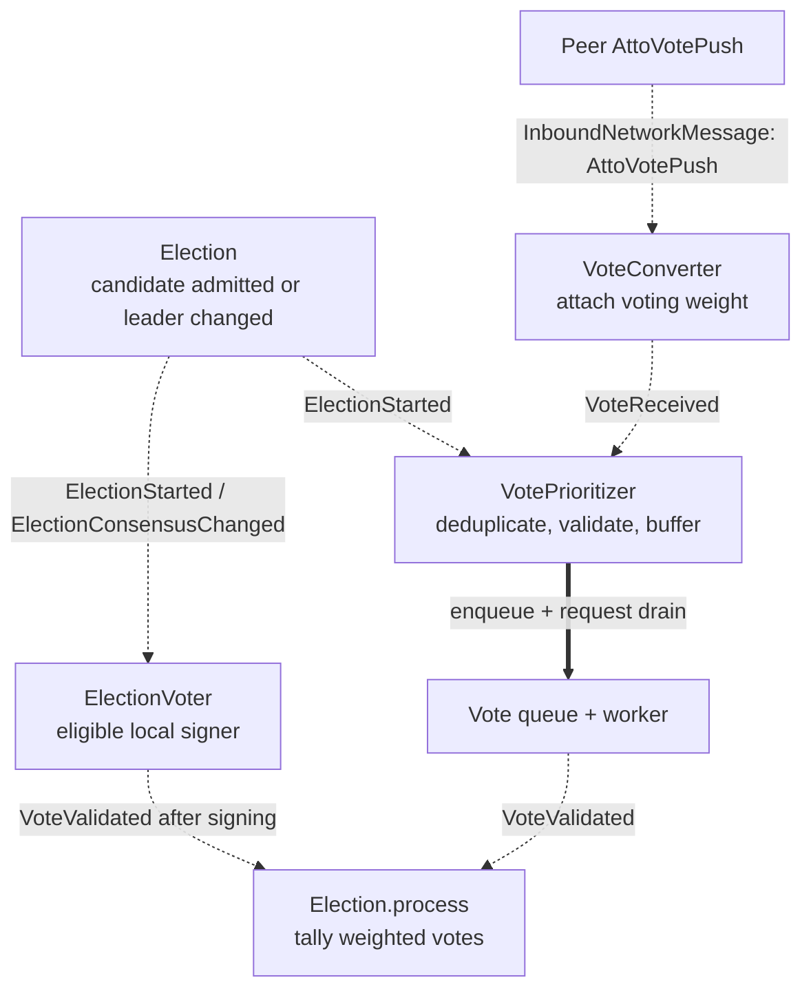

# Transaction Processing and Event Flow

Use this map to trace transaction admission, elections, local persistence, and the completion paths shared with bootstrap.
It describes selected runtime scenarios and the state-changing listeners they depend on; metrics and unrelated network
handlers are omitted. Verify the affected paths in current source before changing behavior.

- [Execution contract](#execution-contract)
- [Live transaction confirmation](#live-transaction-confirmation)
- [Vote processing](#vote-processing)
- [Events and completion](#events-and-completion)
- [State ownership and recovery](#state-ownership-and-recovery)
- [Bootstrap intersections](#bootstrap-intersections)
- [Trace an affected flow](#trace-an-affected-flow)

## Execution contract

The arrows below describe dependencies, not a global timeline. Independent listeners can finish in a different order
from publication, and a listener can publish another event before sibling listeners finish.

| Boundary | Implementation | What it guarantees |
| --- | --- | --- |
| Application event | [EventPublisher.publish][event-publisher] → Spring multicaster | Submits delivery to matching listeners. Publication does not await their completion. |
| Network message event | [NetworkMessagePublisher.publish][network-messages] → the same multicaster | Routes by the concrete wrapper and payload type, such as `InboundNetworkMessage<AttoTransactionPush>`. These messages do not implement the domain `Event` interface. |
| Listener dispatch | [ApplicationConfiguration.applicationEventMulticaster][application-config] | Uses a `SimpleAsyncTaskExecutor` with virtual threads and logs listener failures. This dispatcher supplies no FIFO completion or automatic redelivery guarantee. |
| Queue/worker handoff | [DemandDrivenWorker][worker] plus the caller's owned queue | Coalesces wakeups and drains work in its coroutine. On an exception it requests another drain with backoff; the owner must retain failed work. A wakeup is not the work item. |
| Election lifecycle completion | [ElectionStarted.completion][election] → [TransactionPrioritizer][transaction-prioritizer] callback | An `Election`-owned `Deferred<Unit>` shared by candidates at a public key/height. Its callback wakes the prioritizer's worker. Completion can mean persistence, expiry, or discarded state; it is not a successful-save receipt. |
| Direct suspending call | For example, [AccountService.add][account-service] | The caller awaits the called operation. Any events it publishes still have their own dispatch boundary. |
| After-commit publication | [EventPublisher.publishAfterCommit][event-publisher] | Registers a reactive transaction callback; publishes only after commit. The callback does not await the event consumers. |

Event publication is in-process. It is not a durable queue or proof that a consumer completed. An `@Order` annotation
alone would not serialize asynchronous listener completion. Check each state owner's synchronization separately.

In the diagrams, **dashed arrows** mean asynchronous event delivery, **thick arrows** mean an owned queue/worker
handoff, and **solid arrows** mean the direct call or transaction callback named on the arrow.

## Live transaction confirmation

This diagram follows a transaction that passes validation and reaches consensus. Other listeners and failure branches
are listed in [Events and completion](#events-and-completion).



1. **Admission:** [TransactionController.publishAndConfirm][transaction-controller] checks transaction structure and
   network, registers a hash-specific pending result, and publishes a REST-sourced message. Peer pushes come through
   [NodeConnectionManager.manage][connections]. Both reach `TransactionPrioritizer.add(message)`; rebroadcast tracking
   independently observes the same message.
2. **Prioritization:** [TransactionPrioritizer][transaction-prioritizer] suppresses duplicate hashes, buffers transactions
   whose send/previous dependency is a known pending election, and queues the rest. Its demand-driven worker publishes
   `TransactionReceived`; it does not wait for validation listeners to finish.
3. **Validation:** [TransactionValidationManager.process][validation] loads an account snapshot and calls supported
   validators in order, stopping at the first violation. [BlockValidator][block-validator] checks height and other block
   rules; [PreviousValidator][previous-validator] checks the exact previous hash; [ReceiveValidator][receive-validator]
   checks the receivable for receive/open blocks. The result is `TransactionRejected` or `TransactionValidated`.
4. **Election:** [Election.start][election] owns candidate admission and publishes `ElectionStarted`. Validated votes
   can change the provisional leader or reach consensus. On consensus it removes the active election, keeps a
   `pendingConsensus` completion reference for that public key/height, publishes `ElectionLost` for other candidates,
   and publishes `ElectionConsensusReached`. This is a consensus result; the transaction is still awaiting local persistence.
5. **Persistence:** [ElectionProcessor.process][election-processor] buffers the result by hash and requests its worker.
   The worker selects an insertion-ordered batch with distinct public keys and directly calls `AccountService.add`
   within a reactive transaction. Account updates, historical entries, transactions, and receivable changes share that
   transaction. `AccountUpdated` is registered during this work and published after commit.
6. **Completion:** independently dispatched `AccountUpdated` listeners clear election/persistence state, update voting
   state, and notify streams. `Election` completes the relevant lifecycle references, waking the prioritizer's worker
   to release buffered dependents. A published completion event does not mean every listener has finished. Bootstrap
   also produces this event; consumers must inspect its source where behavior differs.

## Vote processing

Local voting starts from `ElectionStarted`, not directly from `TransactionValidated`. Network votes can arrive before
that listener runs, so [VotePrioritizer][vote-prioritizer] has a buffer for votes without a known election.
The two `Election` boxes show the publishing and consuming roles of the same component.



[ElectionVoter][election-voter] also reacts to consensus reached and expiring/expired elections. After an
`AccountUpdated` from `ELECTION`, it launches final-vote publication for the committed transaction; bootstrap-sourced
updates do not take this branch. An `OLD_TRANSACTION` rejection has a separate account-lookup path for final voting.
Provisional votes broadcast to voters; final votes broadcast to everyone. Network publication and local `VoteValidated`
publication remain separate asynchronous deliveries.

[VoteRebroadcaster][vote-rebroadcaster] independently tracks `VoteReceived`, queues `VoteValidated` for rebroadcast,
and cleans up rejected/dropped votes. [TransactionRebroadcaster][transaction-rebroadcaster] independently tracks inbound
transactions and reacts to validation, rejection, and queue drops. Its dequeue remains scheduled.

## Events and completion

These tables index the relevant behavior listeners, excluding metrics. Read each listed handler's guards: being a
listener does not mean every event changes its state. Definitions live beside their domain types in
[Transaction.kt][transaction-types], [Election events][election-types], [Vote.kt][vote-types], and [Account.kt][account-types].

| Event/message | Producer | Behavior listeners |
| --- | --- | --- |
| `InboundNetworkMessage<AttoTransactionPush>` | [TransactionController][transaction-controller], [NodeConnectionManager][connections] | [TransactionPrioritizer.add][transaction-prioritizer], [TransactionRebroadcaster.process][transaction-rebroadcaster] |
| `TransactionReceived` | [TransactionPrioritizer.drain][transaction-prioritizer]; [LastDiscoverer.startElection][last-discoverer] fallback | [TransactionValidationManager.process][validation] |
| `TransactionValidated` | [TransactionValidationManager.process][validation] | [Election.start][election], [TransactionRebroadcaster.process][transaction-rebroadcaster] |
| `TransactionRejected` | [TransactionValidationManager.process][validation] | [TransactionPrioritizer][transaction-prioritizer], [TransactionRebroadcaster][transaction-rebroadcaster], [VotePrioritizer][vote-prioritizer], [ElectionVoter][election-voter], [DependencyDiscoverer][dependency-discoverer], [TransactionController][transaction-controller] |
| `TransactionDropped` | [TransactionPrioritizer.add][transaction-prioritizer] | [TransactionRebroadcaster][transaction-rebroadcaster], [TransactionController][transaction-controller] |
| `ElectionStarted` | [Election.start][election] | [TransactionPrioritizer][transaction-prioritizer], [VotePrioritizer][vote-prioritizer], [ElectionVoter][election-voter] |
| `ElectionConsensusChanged` | [Election.process][election] | [ElectionVoter][election-voter] |
| `ElectionConsensusReached` | [Election.process][election] | [ElectionProcessor][election-processor], [ElectionVoter][election-voter], [FinalVoteRecorder][final-votes], [VoteTimestampRecorder][vote-timestamps] |
| `ElectionExpiring` | [Election.notifyExpiring][election], scheduled | [ElectionVoter][election-voter], [ElectionProcessor][election-processor] |
| `ElectionExpired` | [Election.expireOld][election], scheduled | [TransactionPrioritizer][transaction-prioritizer], [VotePrioritizer][vote-prioritizer], [ElectionVoter][election-voter], [TransactionController][transaction-controller] |
| `ElectionLost` | [Election][election], on consensus, expiry, or account completion | No production behavior listener currently |
| `VoteReceived` | [VoteConverter][vote-converter] | [VotePrioritizer][vote-prioritizer], [VoteRebroadcaster][vote-rebroadcaster] |
| `VoteValidated` | [VotePrioritizer.drain][vote-prioritizer], [ElectionVoter][election-voter] | [Election][election], [VoteRebroadcaster][vote-rebroadcaster], [VoteWeighter][vote-weighter] |
| `VoteRejected` | [VotePrioritizer.add][vote-prioritizer], on vote validation failure | [VoteRebroadcaster][vote-rebroadcaster] |
| `VoteDropped` | [VotePrioritizer][vote-prioritizer], including buffer eviction | [VoteRebroadcaster][vote-rebroadcaster], [DependencyDiscoverer][dependency-discoverer] |

| After-commit event | Registered by | Behavior listeners |
| --- | --- | --- |
| `AccountUpdated` | [AccountService.add][account-service], for `ELECTION` or `BOOTSTRAP` | [Election][election], [ElectionProcessor][election-processor], [ElectionVoter][election-voter], [VotePrioritizer][vote-prioritizer], [VoteCleaner][vote-cleaner], [VoteWeighter][vote-weighter], [AccountController][account-controller], [TransactionController][transaction-controller] |
| `ReceivableSaved` | [ReceivableService.saveAll][receivable-service] | [ReceivableController][receivable-controller] |
| `AccountEntrySaved` | [AccountEntryService.saveAll][entry-service], historical nodes | [AccountEntryController][entry-controller] |

`TransactionController` completes pending publication results on confirmation, rejection, election expiry, or queue
drop; `ALREADY_CONFIRMED` is handled as confirmation. It does not listen to `ElectionLost`. A request timeout does not
prove the transaction failed to commit. Historical vote and timestamp recording have their own queues; they are not
part of the account transaction merely because they consume the consensus event.

## State ownership and recovery

| State | Owner and synchronization | Completion/failure behavior to preserve |
| --- | --- | --- |
| Transaction priority queue, pending dependency hashes and waiters | [TransactionPrioritizer][transaction-prioritizer]; `dependencyLock` for dependency membership and waiters | Stores each pending hash's shared `ElectionStarted.completion` reference. Completion requests its worker; before draining, it removes completed dependencies and requeues their dependents. `ElectionExpired` separately resets duplicate suppression. |
| Candidates, votes, pending consensus | [Election][election]; mutex, keyed by `PublicKeyHeight` | Consensus moves active work into pending persistence with the lifecycle reference still incomplete. `AccountUpdated` retires active/pending elections for the same key at or below the saved height and completes their references. Only exact-height competitors receive `ElectionLost`; older heights are retired without loser events. Expiry and `clear()` also complete references. |
| Votes awaiting an election and priority queue | [VotePrioritizer][vote-prioritizer]; mutex plus concurrent election membership | `ElectionStarted` releases buffered votes; rejection drops buffered votes; account completion and expiry remove active membership. |
| Consensus awaiting local persistence | [ElectionProcessor][election-processor]; `bufferLock`, hash-keyed `LinkedHashMap`, one drain worker | Exact duplicates retain their insertion position. A batch stops before repeating a public key; remaining work stays queued. On persistence failure, reconcile saved heights, remove obsolete work, and retain unresolved work for retry. |
| Account and receivable caches | [AccountRepository][account-repository], [ReceivableRepository][receivable-repository]; reactive transaction resources and completion callbacks | Account cache updates after commit and evicts on rollback/unknown completion. Receivable cache replacement/removal is conditional on the pending entry's identity, preventing a late callback from restoring deleted state. These callbacks are separate from `AccountUpdated` listeners. |
| Local voting/signing jobs | [ElectionVoter][election-voter]; consensus state, mutexes, coroutine jobs | Provisional updates, cancellation, and committed final-vote publication have distinct lifecycles. Trace them before changing cleanup. |

The intended admission invariant is **one current election height per public key**, with competing hashes at that
height. Validate it through the account snapshot, predecessor checks, and reachable transitions. Do not confuse it with
**one public key per save batch**, which is a separate persistence constraint enforced by `AccountService.add`.

## Bootstrap intersections

Bootstrap can reach the same persistence and completion owners without traversing a normal election. See
[README: Bootstrapping / catching up](README.md#bootstrapping--catching-up) for the broader discovery overview.

| Crossing | Actual calls/events | Why it matters |
| --- | --- | --- |
| Live rejection → dependency discovery | [DependencyDiscoverer][dependency-discoverer] tracks recoverable `TransactionRejected` events and qualifying final `VoteDropped` events; sufficient weight leads to a direct `DiscoveryQueue.queue` call | A rejected live attempt can later enter bootstrap recovery. |
| Discovery → unchecked storage | [DiscoveryQueue][discovery-queue] admits to its bounded buffer, then publishes `TransactionDiscovered`. [BootstrapController.run][bootstrap-controller] drives [DiscoveryPersistenceWorker.persist][discovery-persistence] | `TransactionDiscovered` is a notification after admission, not the command that persists the transaction. |
| Unchecked storage → committed account | [UncheckedTransactionProcessor][unchecked-processor] directly calls `TransactionValidationManager.validate`; on success it calls `AccountService.add(BOOTSTRAP)` inside its resolution transaction | This path bypasses `TransactionReceived`, `TransactionValidated`, and normal election admission, while still producing after-commit `AccountUpdated`. |
| Missing dependency → send discovery | On validation failure, [UncheckedTransactionProcessor][unchecked-processor] publishes `TransactionStuck` and skips later candidates for that public key in the batch. [SendDiscoverer][send-discoverer] consumes `TransactionStuck` and `TransactionDiscovered` | Applicable receive/open transactions trigger discovery of a missing send; follow this loop before treating unchecked work as terminally rejected. |
| Bootstrap head fallback → live validation | [LastDiscoverer.startElection][last-discoverer] publishes `TransactionReceived` for qualifying evicted head discoveries | This producer bypasses the transaction prioritizer and must be included when reasoning about validation admission. |
| Shared completion → source-specific reaction | `AccountUpdated.source` distinguishes `BOOTSTRAP` and `ELECTION` | Most completion owners see both. `ElectionVoter` filters bootstrap updates from its committed-election final-vote path. |

## Trace an affected flow

Use this procedure when investigating events, changing an invariant, or updating this map. Limit the trace to the
scenario and shared state affected by the change; an unrelated edit does not require a whole-repository call graph.

1. **Choose the scenario and invariant.** Name the entry point, transaction hash/public key/height, account snapshot,
   predecessor or send hash, and expected outcome. Include a failure or delayed-event scenario when relevant.
2. **Find the exact type and all producers/consumers.** Search the event type, including generic message payloads.
   Follow construction into variables, publisher wrappers, helper methods, and every production listener. Include
   controllers, recovery, cleanup, and metrics listeners when their behavior affects the question. Search direct
   callers of those methods too; annotations and event names alone do not describe the full path.
3. **Record each relevant edge.** Use the format below with actual symbols and source links. Follow direct validator,
   repository, and service calls as well as events. For a queued edge, record enqueue, wakeup, drain, and removal.
   For a completion signal, identify who owns, completes, and observes it, including failure/cancellation semantics.

   | Producer/caller → consumer/callee | Boundary and completion point | Guard, state owner, failure/cleanup |
   | --- | --- | --- |
   | `Election.process` → `ElectionProcessor.process` | Async `ElectionConsensusReached`; listener only buffers work | Pending consensus lifecycle; processor owns persistence buffer; drain retries unresolved work |
   | `ElectionProcessor.flushBatch` → `AccountService.add` | Awaited call inside a reactive DB transaction | Distinct public keys per batch; after-commit events have separate delivery |
   | `Election` lifecycle completion → prioritizer worker | `Deferred.invokeOnCompletion` callback requests a drain | Owner completes on account update, expiry, or clear; worker releases buffered dependents |

4. **Establish ordering from code.** Read the multicaster, coroutine scopes, locks, queues, schedules, transaction
   operators, and commit/rollback/unknown callbacks. Separate guaranteed order from a possible interleaving. Event
   timestamps, source-file order, and a successful `publish` call do not establish consumer completion order.
5. **Close the feedback loops.** Follow events emitted by listeners through retry, expiry, cancellation, cache
   invalidation, and completion. Check alternate/bootstrap producers that mutate the same owner. Stop when the
   affected invariant and recovery path are explained; record any unresolved edge instead of assuming behavior.
6. **Validate reachability and maintain the map.** Check that test inputs pass upstream validation and predecessor
   checks. Exercise the relevant normal, delayed/duplicate, or failure order. Update the affected arrows, event rows,
   and source links together with the code; distinguish verified behavior from a proposed invariant.

Starting searches from the repository root:

```bash
# Find the exact event/message and its uses, not just listener annotations.
rg -n 'AccountUpdated|ElectionConsensusReached|InboundNetworkMessage<AttoTransactionPush>' src/main/kotlin

# Inspect dispatch and worker behavior, then the affected owners found above.
rg -n 'publishEvent|afterCommit|setTaskExecutor|setErrorHandler|drain|request' src/main/kotlin/cash/atto/node/{Event,ApplicationConfiguration,DemandDrivenWorker}.kt

# Scope deeper mechanism searches to the files/packages identified in your trace.
# If investigating election persistence, for example:
rg -n 'publishAfterCommit|@EventListener|@Order|@Scheduled|worker.request|executeAndAwait|invokeOnCompletion|complete\(' src/main/kotlin/cash/atto/node/election

# Find existing behavior tests after identifying the affected owners.
rg -n 'AccountUpdated|ElectionConsensusReached|ElectionLost' src/test
```

Search matches are an inventory, not a complete call graph. Read the method bodies and follow variables and direct
calls. Keep source links to files and named methods so routine line movement does not invalidate this reference.

[event-publisher]: src/main/kotlin/cash/atto/node/Event.kt
[application-config]: src/main/kotlin/cash/atto/node/ApplicationConfiguration.kt
[network-messages]: src/main/kotlin/cash/atto/node/network/NetworkMessage.kt
[worker]: src/main/kotlin/cash/atto/node/DemandDrivenWorker.kt
[connections]: src/main/kotlin/cash/atto/node/network/NodeConnectionManager.kt
[transaction-types]: src/main/kotlin/cash/atto/node/transaction/Transaction.kt
[transaction-controller]: src/main/kotlin/cash/atto/node/transaction/TransactionController.kt
[transaction-prioritizer]: src/main/kotlin/cash/atto/node/transaction/prioritization/TransactionPrioritizer.kt
[transaction-rebroadcaster]: src/main/kotlin/cash/atto/node/transaction/TransactionRebroadcaster.kt
[validation]: src/main/kotlin/cash/atto/node/transaction/validation/TransactionValidationManager.kt
[block-validator]: src/main/kotlin/cash/atto/node/transaction/validation/validator/BlockValidator.kt
[previous-validator]: src/main/kotlin/cash/atto/node/transaction/validation/validator/PreviousValidator.kt
[receive-validator]: src/main/kotlin/cash/atto/node/transaction/validation/validator/ReceiveValidator.kt
[election]: src/main/kotlin/cash/atto/node/election/Election.kt
[election-types]: src/main/kotlin/cash/atto/node/election/Election.kt
[election-processor]: src/main/kotlin/cash/atto/node/election/ElectionProcessor.kt
[election-voter]: src/main/kotlin/cash/atto/node/election/ElectionVoter.kt
[final-votes]: src/main/kotlin/cash/atto/node/election/FinalVoteRecorder.kt
[vote-timestamps]: src/main/kotlin/cash/atto/node/election/VoteTimestampRecorder.kt
[account-types]: src/main/kotlin/cash/atto/node/account/Account.kt
[account-service]: src/main/kotlin/cash/atto/node/account/AccountService.kt
[account-repository]: src/main/kotlin/cash/atto/node/account/AccountRepository.kt
[account-controller]: src/main/kotlin/cash/atto/node/account/AccountController.kt
[receivable-service]: src/main/kotlin/cash/atto/node/receivable/ReceivableService.kt
[receivable-repository]: src/main/kotlin/cash/atto/node/receivable/ReceivableRepository.kt
[receivable-controller]: src/main/kotlin/cash/atto/node/receivable/ReceivableController.kt
[entry-service]: src/main/kotlin/cash/atto/node/account/entry/AccountEntryService.kt
[entry-controller]: src/main/kotlin/cash/atto/node/account/entry/AccountEntryController.kt
[vote-types]: src/main/kotlin/cash/atto/node/vote/Vote.kt
[vote-converter]: src/main/kotlin/cash/atto/node/vote/convertion/VoteConverter.kt
[vote-prioritizer]: src/main/kotlin/cash/atto/node/vote/prioritization/VotePrioritizer.kt
[vote-rebroadcaster]: src/main/kotlin/cash/atto/node/vote/VoteRebroadcaster.kt
[vote-cleaner]: src/main/kotlin/cash/atto/node/vote/VoteCleaner.kt
[vote-weighter]: src/main/kotlin/cash/atto/node/vote/weight/VoteWeighter.kt
[dependency-discoverer]: src/main/kotlin/cash/atto/node/bootstrap/discovery/DependencyDiscoverer.kt
[discovery-queue]: src/main/kotlin/cash/atto/node/bootstrap/discovery/DiscoveryQueue.kt
[discovery-persistence]: src/main/kotlin/cash/atto/node/bootstrap/discovery/DiscoveryPersistenceWorker.kt
[bootstrap-controller]: src/main/kotlin/cash/atto/node/bootstrap/BootstrapController.kt
[unchecked-processor]: src/main/kotlin/cash/atto/node/bootstrap/unchecked/UncheckedTransactionProcessor.kt
[last-discoverer]: src/main/kotlin/cash/atto/node/bootstrap/discovery/LastDiscoverer.kt
[send-discoverer]: src/main/kotlin/cash/atto/node/bootstrap/discovery/SendDiscoverer.kt
